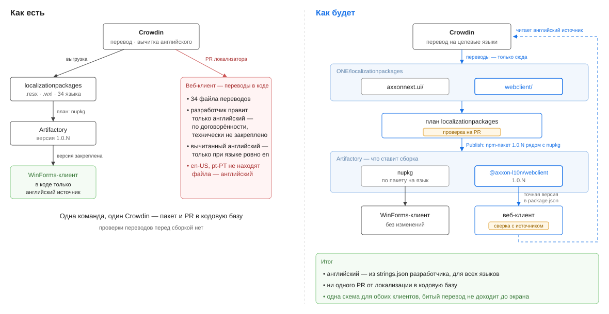

# Локализация веб-клиента из репозитория переводов

Проработка того, как веб-клиент будет получать переводы из
репозитория команды локализации: npm-пакетом закреплённой версии, как
WinForms-клиент получает NuGet-пакеты переводов. В репозитории кода переводов
не остаётся, и PR от локализации в кодовую базу не приходят.

**Статус:** решения приняты. Веб-конфигуратор в эту работу не входит.

| | |
|---|---|
| Эталон | vms-ui после [ACR-83391](https://support.axxonsoft.dev/jira/browse/ACR-83391): переводы в `ONE/localizationpackages`, в приложение приходят пакетом закреплённой версии из плана Bamboo NS-LOCPAC |
| Пакет | `@axxon-l10n/webclient` — версия `1.0.<номер сборки>`, `npm-local` Artifactory |
| Рабочее место локализаторов | Crowdin Enterprise, см. [Crowdin for AxxonSoft](https://internal.axxonsoft.dev/pages/viewpage.action?pageId=209525048) |
| Утилита синхронизации | [ROBO-69636](https://support.axxonsoft.dev/jira/browse/ROBO-69636) — Crowdin sync |
| Соседи в том же репозитории | WinForms-клиент (`axxonnext.ui/`); туда же переезжают локализации драйверов ([IPINT-48321](https://support.axxonsoft.dev/jira/browse/IPINT-48321)) |
| Приложение | `PROJ/axxonnext.webclient` |

---

## Задача

Переводы веб-клиента лежат в его репозитории кода. Команда локализации
коммитит туда напрямую через PR. Разработчики по
договорённости правят только английский источник, а в остальных языках лишь
удаляют перевод строки, у которой изменился английский текст. Технически это
ничем не закреплено.

У WinForms-клиента это уже решено: с мая 2026 года в его репозитории остался
только английский источник, а все языки приходят пакетами из
`ONE/localizationpackages`. Версию пакетов поднимают сборщики одной строкой.

Нужно сделать то же для веб-клиента.

Рамки: разработчики не правят планы сборки и не выпускают сборки (в веб-клиенте
это закреплено решением D-15); новых сервисов и служебных учёток не
появляется; Crowdin остаётся рабочим местом локализаторов.

---

## Рекомендация

Переводы веб-клиента живут в `ONE/localizationpackages` рядом с
переводами WinForms. Основная ветка защищена: переводы попадают туда только
через PR и только пройдя проверку.

Стадия Publish плана переводов — та, что публикует NuGet-пакеты
WinForms-клиента, — публикует рядом с ними **npm-пакет**
`@axxon-l10n/webclient` той же версии `1.0.<номер сборки>`. Запускают её сборщики, как сегодня.

Приложение подключает пакет **точной версией** как необязательную
зависимость. Версия в `package.json` и lockfile — единственная запись о том,
какие переводы в сборке. Поднимают её сборщики одним коммитом, как
`LocalizationVersion` в vms-ui; релизная ветка держит свою версию. В
репозиторий приложения не приходит ни файлов переводов, ни PR от локализации.

Три следствия, которые стоит знать сразу:

- **английский один — `strings.json` разработчика**: он источник для Crowdin и
  он же текст, который видят пользователи, при любом языке браузера. Отдельной
  редакции английского нет: в пакете только остальные языки, английского файла
  в нём нет;
- **локализаторы больше не коммитят в код**, а разработчики не трогают переводы
  и не следят за их версией: у каждого свой репозиторий, версию поднимают
  сборщики;
- **битый перевод не доходит до экрана, а сборка из-за переводов не падает** —
  PR с ошибкой не вливается в переводы, строку, не прошедшую сверку, сборка
  пропускает и показывает английский. Нет пакета или нет языка — тоже
  английский, с предупреждением в журнале; на сборке выпуска — метка Bamboo
  и заметная строка в журнале, чтобы сборщик увидел это до выхода.

Детали — [02 — Что предлагается](docs/02-proposal.md).

---

## Что читать

| | О чём | Кому |
|---|---|---|
| [01 — Как это устроено сегодня](docs/01-current-state.md) | Crowdin и утилита синхронизации, цепочка vms-ui, веб-клиент, найденные дефекты | всем, как общая база |
| [02 — Что предлагается](docs/02-proposal.md) | целевая схема, роли, поведение приложения, процессы работы со строками | всем |
| [03 — Решения](docs/03-decisions.md) | двенадцать принятых решений с отвергнутыми вариантами; открытые вопросы | архитекторам, DDOC, сопровождающим `localizationpackages`, DevOps, сборщикам |
| [04 — Проверка переводов](docs/04-validation.md) | что проверяется, что критично, где стоят проверки | DDOC, разработчикам, DevOps |
| [05 — План, риски, откат](docs/05-plan.md) | этапы, зависимости, чем грозит откат | планированию |
| [06 — Приложение](docs/06-appendix.md) | коды языков в разных системах, покрытие переводов, репозитории и планы | по необходимости |
| [07 — Задачи](docs/07-tasks.md) | десять задач с короткими постановками, порядок и зависимости | планированию, исполнителям |

---

## Что нужно от читателя

1. **Ответы на открытые вопросы** из [03](docs/03-decisions.md): эталонный список
   кодов языков, режим синхронизации источника в Crowdin.
2. **Возражения по фактам.** Если утверждение о коде или процессе неверно — это
   баг документа, и чинить его надо с той же строгостью, что и код.

---

## Метод

Основа — статическое чтение репозиториев WinForms-клиента (`ONE/axxonnext.ui`,
локально — `axxonnext.vms-ui`), `ONE/localizationpackages`,
`ONE/oemizator-resources`, `ONE/ngp.server`, `axxonnext.webclient`, их истории коммитов, а также страниц DDOC в Confluence и
задач в Jira. Цифры покрытия переводов посчитаны скриптом по файлам на
23–25.09.2026.

Приложения не запускались. Где вывод сделан по коду, а не наблюдён, это
помечено явно.

Кода в документах нет намеренно: обсуждается форма решения, а не реализация.

---

## Как вносить правки

Через pull request, по одному на предмет обсуждения. Комментарии удобнее
оставлять построчно в diff, чем в Jira: так видно, к какому именно утверждению
относится возражение.
