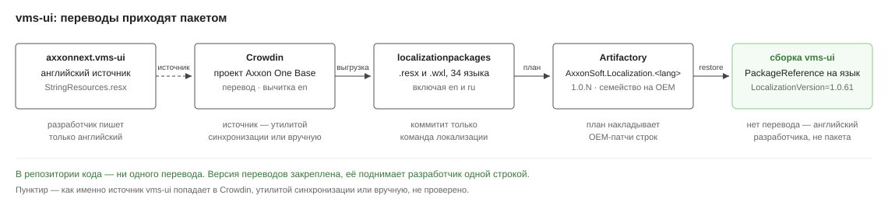

# 01 — Как это устроено сегодня

Два клиента, одна команда локализации — и два разных пути, которыми перевод
попадает в продукт: пакет у WinForms-клиента и PR в репозиторий веб-клиента.
Веб-конфигуратор в эту работу не входит.
Документ фиксирует факты; где вывод сделан по коду, а не наблюдён, это
помечено.

---

## Crowdin — рабочее место локализаторов

Команда локализации (отдел DDOC) переводит в **Crowdin Enterprise**,
`xnsft.crowdin.com`. Страница
[Localization Crowdin](https://internal.axxonsoft.dev/pages/viewpage.action?pageId=221745986)
перечисляет проекты: Axxon One Base, Axxon One Installer, **Web Client**,
Web Configurator, AxxonNet, AxxonData, AxACFA, мобильные клиенты, Detector
Pack, Drivers Pack.

По [Crowdin for AxxonSoft](https://internal.axxonsoft.dev/pages/viewpage.action?pageId=209525048):

- **исходный язык — английский** во всех проектах, кроме паков детекторов и
  драйверов;
- **английский — ещё и целевой язык**: «English, United States», его ведёт
  штатный специалист по локализации. Это и есть вычитанный английский, который
  отличается от написанного разработчиком; в новой схеме веб-клиента он не
  используется;
- **проверки качества включены**, в том числе проверка плейсхолдеров
  (Variables): перевод с неверными плейсхолдерами в редакторе не сохранить.
  Переводы, сделанные до Crowdin, эта проверка не касается — ошибки
  плейсхолдеров в текущих файлах оттуда;
- **что происходит с переводом, когда меняется источник**, задаёт режим
  синхронизации источника: «Clear all translations and approvals», «Keep
  translations» или «Keep translations and approvals». Рекомендован и выбран
  по умолчанию **Keep translations**: перевод остаётся, но проверка качества
  «Outdated translations» помечает его устаревшим, и локализаторы видят его в
  фильтре;
- **выгружается всё, у чего есть хотя бы один перевод** — настройка экспорта.
  Значит, помеченный устаревшим перевод в выгрузку попадает, пока его не
  поправили;
- **активных языков 32**, включая английский и русский, а в сборке
  WinForms-клиента их 33 (`RequestedLanguages`);
- **коды языков при выгрузке** задаются маппингом проекта. Для Web Client —
  «как в Base»: двухбуквенный код плюс `es-MX`, `pt-PT`, `pt-BR`, `zh-Hant`,
  `zh-SG`.

### Как файлы ходят между репозиторием и Crowdin

**Утилита Crowdin sync** ([ROBO-69636](https://support.axxonsoft.dev/jira/browse/ROBO-69636),
команда ROBO). Настольное приложение, запускается локализатором с личными
токенами Crowdin и Bitbucket. Задумана так, чтобы забирать английский источник
из репозитория в Crowdin и выгружать переводы в заданный репозиторий и ветку.
По инструкции DDOC утилита в тестовом режиме: работают настройка файлов и
синхронизация источника, а выгрузка переводов помечена «Not available/tested».
Именно поэтому перенастройка выгрузки — задача для ROBO, а не настройка на
месте.

Цель утилиты сформулирована в задаче прямо: *«для защиты кода продукта было
решено выделить отдельный репозиторий для локализаций»*. Наша проработка —
продолжение той же линии.

Читать источник из одного репозитория и выгружать переводы в другой утилита
сегодня не умеет — это доработка у ROBO.

**Родная интеграция Crowdin с Bitbucket** — в Drivers Pack
([IPINT-48322](https://support.axxonsoft.dev/jira/browse/IPINT-48322)):
`crowdin.yml` в репозитории переводов, синхронизация раз в час, переводы
приходят PR из ветки `l10n`.

---

## vms-ui — эталон

С 06.05.2026 (PR #11875, [ACR-83391](https://support.axxonsoft.dev/jira/browse/ACR-83391))
в `axxonnext.vms-ui` лежит только английский источник — `StringResources.resx`
и `InstallerStringResources.resx`. Всё остальное приходит пакетами.

| Звено | Где | Что делает |
|---|---|---|
| Репозиторий переводов | `ONE/localizationpackages`, `axxonnext.ui/Localization/Resources/<lang>/` | `.resx` и `.wxl` на 34 языка, **включая `en` и `ru`**; в сборку идут 33 из `RequestedLanguages` — персидского там нет; коммитит команда локализации через PR |
| Сборка пакетов | план Bamboo NS-LOCPAC «Localization Packages»: `build.bamboo.xml`, `Localization.csproj` | nupkg на каждый язык: `AxxonSoft.Localization.<lang>`, версия `1.0.<номер сборки>`; стадию Publish запускают сборщики вручную |
| OEM | `build.bamboo.xml`, цель `PrepareOemResources` | параметр `oemVendor` накладывает патчи из `oemizator-resources` и даёт отдельное семейство пакетов, например `LUMINYS.Localization.*` |
| Публикация | `artifactory-publish.spec` | Artifactory, `nuget-local/<oem>/Localization/<версия>/` |
| Подключение | vms-ui, `Build/ant/BuildWin.Product.targets.xml:32-45` | сборка генерирует `Localization.props` с `PackageReference` на каждый язык |
| Версия и языки | vms-ui, `Build/Oem/AxxonSoft/oem.properties:28-30` | `LocalizationVersion=1.0.71`, список `RequestedLanguages`; Bamboo-переменная `languagesToBuildInstaller` его переопределяет |

Подъём версии — однострочная правка `oem.properties` после выхода нового
пакета. Её делают сборщики (компонент «4 Build») отдельным коммитом с ключом
тикета локализатора или постоянного тикета подъёма версий
([ACR-86237](https://support.axxonsoft.dev/jira/browse/ACR-86237)); с июля
2026 года — 13 раз.

Во время работы .NET берёт строку из сателлитной сборки языка, а при её
отсутствии — **из нейтрального английского разработчика**, минуя пакет `en`.
*Вывод по стандартному поведению `ResourceManager`; своего кода отката в vms-ui
нет.*

---

## Веб-клиент

**Файлы.** `src/shared/i18n/locales/`: `strings.json` — английский источник,
1427 ключей (на 09.11.2026); плюс 34 файла `strings-<lang>.json`, среди них отдельный
`strings-en.json`. Формат плоский, ICU.

**Загрузка.** `src/shared/i18n/lib/locale.ts:11-18`: всегда грузится
`strings.json`, поверх него — `strings-<lang>.json` динамическим импортом по
шаблону. Ошибка загрузки проглатывается, пользователь получает английский.

**Выбор языка.** `src/entities/locale/model/saga.ts:22-24`: cloud-локаль из
родительского окна, иначе `navigator.language` целиком. Только `ru-*`
сокращается до `ru`. Поэтому `de-DE`, `en-US`, `pt-PT` не находят файла и
получают источник. Списка поддерживаемых языков нет — поддерживается то, для
чего есть файл; `DISABLED_LANG` — переменная сборки, но список из неё
попадает в код и исключает языки во время работы.

**Вычитанный английский видят немногие.** `strings-en.json` отличается от
источника в **250 значениях из 818**, но грузится только при языке браузера
ровно `en`. Пользователь с `en-US` видит английский разработчика. В новой
схеме этот файл не используется: английский — только `strings.json`.

**Переводы не попадали в сборку — исправлено 24.09.2026.** После переезда
загрузчика в `src/shared/i18n/lib/locale.ts` 12.08.2026 (DANV-8774)
`vite.config.ts` ограничивал плагин динамического импорта старым путём, и в
сборку попадал только английский. Путь поправлен в DANV-9171.

**Кто коммитит.** Локализаторы — через PR (последние — WEBUI-433 от 04.11.2026, до него WEBUI-197 и DANV-9240).
Разработчики по негласной договорённости правят только английский источник. В
остальных языках они лишь удаляют перевод строки, у которой изменился
английский текст: устаревший перевод пропадает, и до нового перевода строка
показывается по-английски. Технически это ничем не закреплено: репозиторий
не мешает разработчику изменить любой файл перевода.

**Поставка.** `npm run bamboo` → `webclient.zip`, план `ASIP-ANWC282`. Архив
забирает сборка сервера: `ONE/ngp.server`, `build/Common.xml:209-224`.

---

## Сводка

| | vms-ui | Веб-клиент |
|---|---|---|
| Переводы в репозитории кода | только английский источник | 34 файла |
| Как переводы попадают в код | пакетом из Artifactory | PR локализатора |
| Вычитанный английский | весь продукт | только язык браузера ровно `en` |
| Кто решает, какие языки есть | приложение, `RequestedLanguages` | наличие файла |
| OEM | строки и их переводы — патчи из `oemizator-resources` в плане переводов | строк нет; название, логотип, тема и компоненты вендора подменяются при сборке из `oemizator-resources` |
| Версия переводов | закреплена | = коммит кода |
| Проверка перед сборкой | нет, валидатор запускают вручную | нет |

Одна команда, один Crowdin — и два несовместимых процесса.
