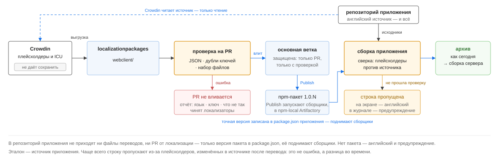
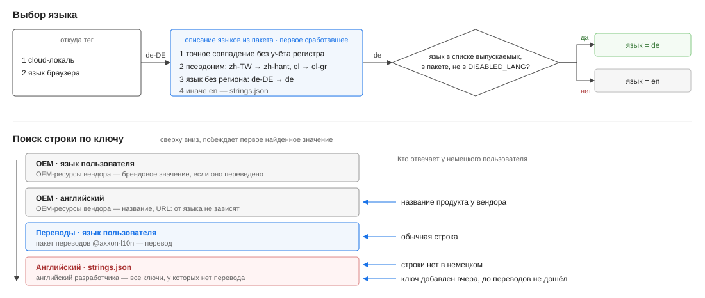
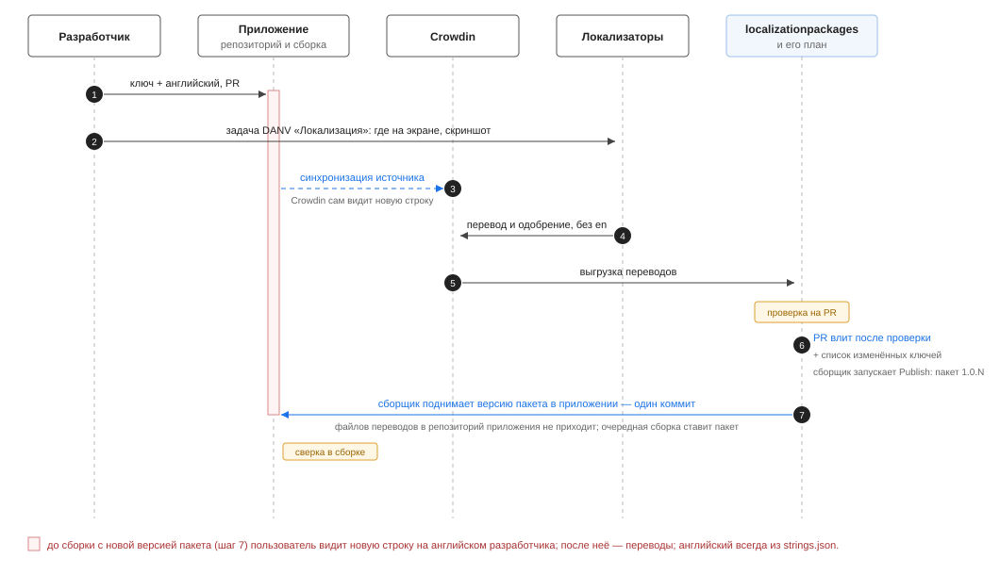

# 02 — Что предлагается

Схема для веб-клиента: переводы живут в репозитории команды локализации и
приходят в приложение npm-пакетом закреплённой версии — так же, как в
WinForms-клиент приходят NuGet-пакеты переводов. Веб-конфигуратор в эту работу
не входит.

---

## Схема

1. **Crowdin читает английский источник прямо из репозитория приложения**,
   только на чтение — как сегодня. Новые, изменённые и удалённые строки он
   находит сам.
2. **Переводы выгружаются в `ONE/localizationpackages`**, в папку `webclient/`
   рядом с существующей `axxonnext.ui/`. В репозиторий приложения они больше
   не попадают. Перевод строки, у которой изменился
   источник, Crowdin помечает устаревшим — он остаётся в выгрузке, пока
   локализаторы его не поправят.
3. **Переводы попадают в основную ветку только через PR и только проверенными.**
   Основная ветка репозитория переводов защищена: прямой push запрещён, PR
   проходит ревью локализации и обязательную проверку целостности файлов.
   Битый перевод в неё не попадает вовсе.
4. **План переводов публикует npm-пакеты.** Стадия Publish плана NS-LOCPAC — та
   же, что публикует NuGet-пакеты WinForms-клиента, — собирает из основной
   ветки `@axxon-l10n/webclient` версии `1.0.<номер сборки>` и кладёт их в `npm-local` Artifactory. Запускают её
   сборщики, как сегодня.
5. **Приложение подключает пакет точной версией.** Версия записана в
   `package.json` и lockfile — это единственная запись о том, какие переводы в
   сборке. Поднимают её сборщики одним коммитом, как `LocalizationVersion` в
   vms-ui. Сборка приложения ставит зависимости, как сегодня; план ничего не
   переопределяет.
6. **Сборка сверяет переводы со своим источником и не падает.** Эталон —
   английский источник в репозитории приложения. Строку перевода, которая не
   прошла проверку, сборка пропускает: на экране для этого ключа остаётся
   английский, в журнале сборки — предупреждение. Нет пакета или нет языка —
   тоже английский и предупреждение; на сборке выпуска — метка. Архив
   собирается, как сегодня.

---

## Кто за что отвечает

| Роль | Отвечает за | Больше не делает |
|---|---|---|
| Разработчик | английский источник; задача на локализацию с контекстом; список выпускаемых языков по решению владельца продукта; механизм наложения OEM-строк и неизменность ключей, на которые ссылаются OEM-компоненты | не правит файлы переводов, не ведёт коды языков, не готовит содержимое OEM, не следит за выходом переводов и не поднимает версию пакета |
| Команда локализации | все языки, кроме английского: английский веб-клиента — `strings.json` разработчика; одобрение переводов; выгрузку в `localizationpackages` | не коммитит в репозитории кода |
| Сборщики | запуск стадии Publish плана переводов; подъём версии пакета в приложении — в `master` и, если нужно, в релизной ветке; откат на прежнюю версию | — |
| Сопровождающие `localizationpackages` | структуру папок и состав файлов; описание языков вместе с DDOC; проверку переводов на PR; публикацию npm-пакетов в своём плане | — |
| Сопровождающие OEM-ресурсов (`oemizator-resources`) | содержимое OEM: название, URL и другие брендовые строки вендора; заказ их переводов через репозиторий переводов | — |
| DevOps | защита основной ветки репозитория переводов; право плана переводов публиковать в `npm-local` | — |

---

## Как переводы попадают в сборку

**Пакет.** Приложение подключает `@axxon-l10n/webclient` точной версией в
`optionalDependencies`. Сборка
ставит его из `npm-local` вместе с `@axxon-web/*`, которые оттуда уже
приходят; отдельного шага в плане сборки нет.

**Что в пакете.**

- Плоские JSON по одному на язык, имена файлов — коды продукта, например
  `de.json`, `el-gr.json`, `zh-hant.json`. Английского файла в пакете нет:
  английский — `strings.json` в репозитории приложения. Формат не меняется:
  ключи и ICU-строки те же, что сегодня.
- **Описание языков**: коды продукта и псевдонимы тегов браузера
  (`zh-CN → zh-sg`, `el → el-gr`). Его ведут сопровождающие
  `localizationpackages` вместе с DDOC, а не разработчики приложений.
- Переводы WinForms-клиента и OEM-патчи в пакет не входят.

Окончательный список кодов — открытый вопрос в [03](03-decisions.md).

**Список выпускаемых языков.** Какие языки выпускает приложение, решает
продукт, поэтому список лежит в репозитории приложения — как `shipped-locales`
у Firefox и `RequestedLanguages` у vms-ui. Язык показывается, только если он в
списке и у пакета есть его файл. Язык в списке без файла — предупреждение в
сборке, пользователь видит английский; файл без языка в списке в сборку не
берётся. Меняет список владелец продукта отдельным коммитом.

**Какая версия.** Точная, из `package.json` и lockfile; поднимают её сборщики
(см. «Как приходят новые переводы»). Сборка пишет версию пакета в журнал и
предупреждает, если в Artifactory есть версия новее: забытый подъём виден на
сборке, а не после выхода.

**Если пакета нет.** Artifactory недоступен или версия не найдена — сборка идёт
дальше на английском источнике и пишет предупреждение; на сборке выпуска —
метка, чтобы сборщик увидел сборку без переводов до выхода: заметная строка
предупреждения в журнале сборки Bamboo и метка Bamboo на сборке, например
`l10n-missing`. Сборка из-за
переводов не падает никогда: запасной английский есть всегда.

**Локально.** `npm install` ставит пакет, и разработчик видит все языки. Без
доступа к Artifactory — английский источник и предупреждение в консоли.

**Бренд.** Переводы нейтральны к бренду. OEM-слой в них не входит — см. решение
Р7 в [03](03-decisions.md).

---

## Поведение приложения во время работы

### Выбор языка

Как теги браузера соответствуют кодам,
приложение берёт из описания языков в пакете; какие языки выпускаются — из
своего списка.

1. **Откуда берётся тег** — как сейчас: cloud-локаль, иначе язык браузера.
2. **Тег превращается в код продукта** первым сработавшим правилом: точное
   совпадение без учёта регистра → псевдоним из описания языков → язык без
   региона (`de-DE → de`) → `en`, то есть английский из `strings.json`.
3. **Код проверяется по списку выпускаемых языков, наличию файла в пакете и по
   `DISABLED_LANG`.** Не прошёл — `en`. `DISABLED_LANG` остаётся в сборке: им
   OEM отключает языки.

Алгоритм снимает ловушку, в которой `en-US` и `pt-PT` не находят файла.

### Поиск строки

Для каждого ключа берётся первое найденное значение:

| Слой | Откуда | Зачем |
|---|---|---|
| OEM, язык пользователя | OEM-ресурсы вендора | брендовое значение, если оно переведено |
| OEM, английский | OEM-ресурсы вендора | брендовое значение — не зависит от языка |
| Переводы, язык пользователя | пакет переводов | перевод |
| Английский | `strings.json` в репозитории приложения | английский разработчика — для всех ключей, у которых перевода нет |

Английский в продукте один — `strings.json` разработчика. Английского слоя в
пакете нет, отдельной редакции английского в Crowdin для веб-клиента нет.

Строка перевода, которая не прошла проверку при сборке, пропускается, и поиск
идёт к следующему слою. Чаще всего это строка, у которой набор плейсхолдеров не
совпадает с источником: перевод сделан до изменения источника. Сборка пишет
предупреждение — см. [04](04-validation.md).

### Что грузится

Это поведение приложения, а не действие человека: приложение само грузит
английский источник — всегда, язык пользователя —
отдельным чанком по требованию. Подключение пакета и удаление файлов остальных
языков из репозитория разработчики приложения делают один раз, при
переключении (Т8 в [07](07-tasks.md)); дальше руками здесь никто ничего
не делает.

### Что не меняется

Ключи, `formatMessage`, формат строк. Локаль MUI и date-fns по-прежнему следует
за браузером — выровнять её с языком приложения можно отдельной задачей.

---

## Процессы

### Новый ключ

1. Разработчик добавляет ключ в английский источник и в код. Пока ключа нет в
   переводах, пользователи видят английский разработчика.
2. Заводит задачу DANV «Локализация»: ключи, английский текст, где строка на
   экране, скриншот.
3. Crowdin находит новую строку при синхронизации источника. Локализаторы
   переводят и одобряют её на всех целевых языках; английский не меняют.
4. Переводы приходят PR в `localizationpackages`, проверка на PR пропускает их
   в основную ветку.
5. Сборщик запускает Publish — выходит новая версия пакета — и поднимает её в
   приложении одним коммитом. Очередная сборка приносит новый текст в продукт.
   Разработчик в этом не участвует.

### Изменение текста

**Одно правило без исключений: меняешь текст — меняешь его в том же ключе.**
Новый ключ заводится только для новой строки интерфейса. Разработчику не нужно
решать, поменялся ли смысл или набор плейсхолдеров.

Безопасность этого правила держится на автоматике, а не на внимательности:

1. **Crowdin видит расхождение и показывает его локализаторам.** При
   синхронизации источника перевод изменённой строки помечается проверкой
   «Outdated translations», и локализаторы находят такие строки фильтром. Это
   поведение по умолчанию — режим «Keep translations», рекомендованный
   инструкцией DDOC. Цена: помеченный перевод выгружается дальше, поэтому до
   правки пользователь видит старый текст.
   Второй режим, «Clear all translations and approvals», переводы изменённых
   строк стирает: пользователь сразу видит английский разработчика, но так же
   теряются переводы и от правки опечатки. Какой режим включить веб-проектам —
   открытый вопрос к DDOC (Т6).
2. **Сборка пропускает строки переводов, не совпадающие с источником.** Если
   приложение собирается с переводами, сделанными до изменения, и набор
   плейсхолдеров у ключа разошёлся, для этого ключа берётся английский из
   `strings.json`, и сборка пишет предупреждение. Сломанной строки на экране не будет.

Перевод заново запускает не человек, а Crowdin: при синхронизации источника он
сам видит изменённую строку, помечает её перевод устаревшим и показывает
локализаторам. Отдельная задача для этого не нужна.
Задачу DANV «Локализация» ради контекста — где строка на экране, скриншот —
заводит разработчик, который поменял текст, так же, как для нового ключа.

### Удаление ключа

Разработчик удаляет ключ из кода и источника. Crowdin видит удаление при
синхронизации. Лишний ключ в переводах ничего не ломает и вычищается
локализаторами. Правило «удалять мёртвый ключ из всех файлов» заменяется на
«удалить из источника».

### Как приходят новые переводы

Разработчик за переводами не следит и ничего не вливает. Новую версию пакета в
приложение приносят сборщики — тот же человек и тот же порядок, что для
`LocalizationVersion` WinForms-клиента:

1. Локализатор закрывает свой тикет «Локализовать изменения из …».
2. Сборщик запускает Publish плана переводов — выходят NuGet-пакеты
   WinForms-клиента и npm-пакет одной версии.
3. Сборщик поднимает версию пакета в приложении одним коммитом с ключом этого
   тикета или постоянного тикета подъёма версий
   ([ACR-86237](https://support.axxonsoft.dev/jira/browse/ACR-86237)) — в
   `master` и, если нужно, в релизной ветке.

Содержимое переводов разработчик не проверяет и не может проверить: за текст
отвечают локализаторы в Crowdin и проверка на PR, строку с ошибкой на экран не
пускает сверка в сборке.

Релизная ветка наследует версию в момент отрезания и держит её, поэтому текст
вышедшей версии зафиксирован: пересборка даёт то же самое. Исправление перевода
для вышедшей версии — новая публикация и подъём версии в этой ветке. Новая
версия может нести строки следующего выпуска, это безвредно: ключей, которых
нет в коде, приложение не запрашивает.

Плохой, но формально верный перевод откатывается так же: сборщик возвращает в
приложении прежнюю версию.

### Новый язык

Локализаторы добавляют язык в Crowdin, сопровождающие `localizationpackages`
вносят его в описание языков — и он приходит с очередной версией пакета.
Выпускать ли его, решает владелец продукта: язык попадает в список выпускаемых
отдельным коммитом в репозиторий приложения. Тогда же выясняется, нужно ли
языку что-то от самого приложения — RTL-вёрстка, локаль MUI или date-fns;
такие языки (`ar`, `he`, `fa`) уже есть, и это отдельная задача.

### OEM

Переводы нейтральны к бренду, брендовые строки накладываются сверху.
Английские брендовые значения — название, URL — это брендинг, как логотип: они
лежат вместе с остальными OEM-ресурсами вендора. Содержимое дают
сопровождающие OEM-ресурсов; если вносить его в репозиторий приложения,
разработчик делает это отдельной задачей, но не сочиняет и не переводит.
Отдельного канала для OEM нет. Переводы OEM-строк на другие языки — это файлы
локализации, они идут через репозиторий переводов, как OEM-патчи строк у
WinForms-клиента; в вебе переведённых OEM-строк пока нет. За разработчиком —
механизм наложения и неизменность ключей, на которые ссылаются OEM-компоненты.

Сегодня OEM-ресурсы веб-клиента уже лежат в `oemizator-resources`: при сборке
подменяются название, логотип, тема и отдельные компоненты. Брендовых строк
нет, поэтому и слоёв OEM в поиске строки нет; они появятся, когда понадобятся.

OEM может отключить язык через `DISABLED_LANG` в сборке.

### Права

Локализаторам больше не нужна запись в `PROJ/axxonnext.webclient`, она
отзывается (Т9). Чтение нужно утилите синхронизации — чтобы Crowdin видел
источник. Права открывать PR в репозитории приложения не нужны никому: в
кодовую базу от локализации больше ничего не приходит.

Сборщикам нужна запись в репозиторий веб-клиента — для коммита с версией
пакета, так же как в vms-ui для `LocalizationVersion`. Есть ли она у них
сегодня, не проверено — это часть Т7.

В репозитории переводов права и защита нужны такие:

| Что | Как |
|---|---|
| Разработчики приложений | чтение |
| Команда локализации | запись только через PR, ревью по владельцам файлов |
| Основная ветка | без прямого push и без force-push; PR не вливается, пока не прошла проверка переводов |
| Ветка выгрузки Crowdin | без force-push; вливает её лид локализации |
| План NS-LOCPAC | право публиковать `@axxon-l10n/*` в `npm-local` Artifactory |

Без защиты ветки схема держится на честном слове: прямой push в основную ветку
молча меняет текст в следующем пакете. Служебных учёток, которые открывают или
вливают PR, нет — всё, что меняет репозиторий приложения, делает человек.

---

## Что меняется для каждого

| Кто | Было | Станет |
|---|---|---|
| Пользователь с `pt-PT`, `es-419`, `de-AT` и т. п. | английский: файл не находится | свой язык |
| Пользователь на английском | английский разработчика, при языке браузера ровно `en` — отдельный `strings-en.json` | английский из `strings.json` разработчика при любом английском теге |
| Разработчик | правит источник, в остальных языках удаляет устаревший перевод — по договорённости | правит только источник, в том же ключе; после `npm install` видит все языки; версию переводов не трогает |
| Сборщик | поднимает `LocalizationVersion` WinForms-клиента | тем же порядком поднимает `@axxon-l10n/webclient` в веб-клиенте |
| Локализатор | коммитит в репозиторий кода через PR | работает только в Crowdin; его выгрузка и есть то, что попадает в пакет |
| Ревьюер PR | видит переводы вперемешку с кодом | видит только код; от сборщиков — коммит с одной строкой версии |
