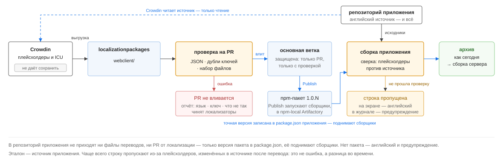

# 04 — Проверка переводов

Критическая ошибка в переводах не должна доходить до продукта. Проверки уже
есть — в Crowdin; задача не в том, чтобы придумать свои, а в том, чтобы закрыть
то, чего Crowdin структурно не видит, и не проверять одно и то же дважды.

---

## Что уже сломано

Найдено в текущих файлах веб-клиента.

| Где | Что | Чем грозит |
|---|---|---|
| веб-клиент, `it`, `dateInput.minDateDenied` | в переводе `{maxDate}`, в источнике `{minDate}` | строка не форматируется, пользователь видит сырые скобки |
| веб-клиент, `es-MX`, `compromised.alert` и `compromised.dialog.content` | в переводе пропали `{hostName}` и `{details}` | сообщение без имени узла и без деталей |
| веб-клиент, `fa` | нет 843 ключей из 1427 (на 09.11.2026) | непереведённые строки |

Всё это — наследие переводов, сделанных до Crowdin: его проверки на них не
распространялись.

---

## Кто что проверяет

| Проверка | Где | Что ловит | Что делает |
|---|---|---|---|
| Crowdin | при сохранении перевода | плейсхолдеры и ICU в строке | не даёт сохранить |
| Проверка на PR | PR в основную ветку репозитория переводов | целостность файлов | PR не вливается |
| Сверка в сборке | `vite build` приложения | перевод против источника разработчика, языки против списка выпускаемых | строка или файл отбрасывается, предупреждение |

Отдельный случай: переводов нет вовсе — Artifactory недоступен или версии
пакета нет. Сборка идёт дальше на английском источнике и пишет предупреждение;
на сборке выпуска — метка, чтобы сборщик увидел сборку без переводов до
выхода: заметная строка предупреждения в журнале сборки Bamboo и метка Bamboo
на сборке, например `l10n-missing`. npm сам об отсутствии пакета молчит —
`npm ci` без необязательной зависимости завершается с кодом 0, — поэтому
отсутствие замечает плагин сборки. Сборка из-за переводов не падает никогда: запасной английский есть
всегда.

### Что именно проверяется

| Проверка | Где | Уровень |
|---|---|---|
| Плейсхолдеры перевода и ICU-синтаксис | Crowdin | строку не сохранить |
| JSON разбирается | проверка на PR | **критично** |
| В файле нет повторяющихся ключей | проверка на PR | **критично** |
| Набор файлов согласован с описанием языков: у каждого языка есть файл, каждый файл описан, псевдонимы ведут на существующие коды | проверка на PR | **критично** |
| В пакете нет английского файла | проверка на PR | **критично** |
| Плейсхолдеры перевода не совпадают с источником приложения | сверка в сборке | строка отбрасывается, предупреждение |
| Ключ источника отсутствует в переводах | сверка в сборке | предупреждение |
| Язык есть в списке выпускаемых, а файла в пакете нет | сверка в сборке | предупреждение, язык показывается английским |
| Файл есть в пакете, а языка в списке выпускаемых нет | сверка в сборке | файл в сборку не берётся |
| Пакета нет | сборка | предупреждение; на сборке выпуска — метка |

Проверка на PR смотрит на файлы, а не на строки: `JSON.parse` повторяющиеся
ключи молча проглатывает — побеждает последний, — а ручная правка или неудачное
слияние проходят мимо Crowdin вообще. Плейсхолдеры и ICU здесь второй раз не
проверяются: это уже сделано при сохранении.

---

## Как сверяются плейсхолдеры

**Источник** — дефолтный английский файл разработчика в репозитории приложения,
`strings.json`. Английского файла в пакете нет, сверяются только переводы
остальных языков.

Для каждого ключа, который есть и в источнике, и в переводе:

1. Оба текста разбираются `@formatjs/icu-messageformat-parser` — тем же
   парсером, которым react-intl форматирует строки во время работы. Что понял
   парсер, то и увидит пользователь.
2. Из разобранного дерева рекурсивно собираются имена аргументов — включая те,
   что появляются внутри веток `plural`, `select`, `selectordinal`, и `#`.
3. Множества имён сравниваются.

| Случай | Пример | Решение |
|---|---|---|
| В переводе есть имя, которого нет в источнике | `it`: `{maxDate}` вместо `{minDate}` | строка отбрасывается, предупреждение |
| В переводе не хватает имени из источника | `es-MX`: нет `{hostName}` | строка отбрасывается, предупреждение |
| Имена совпали, разошёлся тип | `{count, number}` против `{count}` | строка остаётся, предупреждение |
| Ключа в переводе нет | — | ничего: сработает обычный порядок поиска |

Отброшенная строка просто не попадает в бандл, поэтому во время работы
для этого ключа показывается английский из `strings.json`. Отдельной
логики в приложении для этого не нужно.

Не сравниваются порядок аргументов, число повторов одного имени, сам текст,
пробелы и знаки препинания — это работа локализаторов.

### Чего сверка не делает

Она не читает текст. Не оценивает качество перевода, не проверяет, весь ли
язык переведён, и не пытается понять, изменилась ли формулировка на английском
и догнали ли её остальные языки. Со стороны сборки перевод остаётся чёрным
ящиком: сравниваются только имена аргументов ICU — контракт между кодом и
строкой. Код передаёт `{hostName}` — строка обязана его использовать, на любом
языке; всё остальное в ней дело локализаторов.

Сравнить одни только наборы ключей для этого мало: у `dateInput.minDateDenied`
ключ есть и в источнике, и в переводе, а плейсхолдер разошёлся — и пользователь
видит сырые скобки.

Сколько это ловило на 25.09.2026: три строки на 828 ключей и 34 языковых файла —
`compromised.alert` и `compromised.dialog.content` в `es-MX`,
`dateInput.minDateDenied` в `it`. Все три — наследие до Crowdin. Кроме них у сверки остаётся один случай: разработчик поменял
набор плейсхолдеров у существующего ключа, а перевод пришёл старый — это цена
правила Р12. Если DDOC включит стирающий режим синхронизации, исчезает и он:
перевод изменённой строки пропадёт, и сработает обычный порядок поиска.

Почему парсером, а не регулярным выражением: `{count, plural, one {# файл}
other {# файлов}}`, вложенные `select` и экранирование кавычками дают ложные
срабатывания. Утилита проверки ресурсов WinForms-клиента написана как раз на
регулярном выражении под `{0}` и на `plural` спотыкается.

Объём работы: 1427 ключей и 34 языковых файла — около 48 тысяч строк, разбор
занимает доли секунды один раз за сборку.

---

## Почему сверка в сборке не дублирует Crowdin

Crowdin сравнивает перевод с тем источником, который лежит **у него** на момент
сохранения. Сборка сравнивает с источником, который лежит **в репозитории
приложения** на момент сборки. Отсюда три случая, которые Crowdin закрыть не
может.

1. **Наследие до Crowdin.** Проверки на него не распространялись — см. «Что уже
   сломано».
2. **Расхождение во времени — главный случай.** Разработчик меняет строку,
   Crowdin помечает перевод устаревшим, но в режиме «Keep translations»
   продолжает его выгружать. Проверка Crowdin когда-то прошла — против старого
   источника. Именно на отбрасывании таких строк держится правило ключей Р12 из
   [03](03-decisions.md).
3. **Всё, что пришло мимо Crowdin:** правка руками в репозитории переводов,
   перенос файлов при миграции, восстановление из истории.

Если DDOC выберет режим «Clear all translations and approvals», второй случай
почти исчезает: переводы изменённых строк стираются. Тогда сверку в сборке
можно свести к предупреждениям — она останется страховкой от наследия и ручных
правок.

---

## Проверка на PR

- **Когда:** на каждом PR в основную ветку репозитория переводов —
  обязательная проверка, без которой PR не вливается.
- **Критическая ошибка:** проверка красная, **PR не вливается**. В основную
  ветку битый файл не попадает, в пакет — тоже: пакет собирается только из
  неё. Пакеты WinForms-клиента этой проверкой не затрагиваются.
- **Чем выполняется:** небольшим скриптом в том же плане. Переучивать
  `ITV.ResxFileValidator` не нужно: он читает только `.resx` и `.wxl`, в тихом
  режиме не выводит результаты и всегда возвращает ноль, а проверки строк, ради
  которых его брали, теперь делает Crowdin.
- **Отчёт:** артефакт проверки — файл, ключ, что не так. Рядом — список ключей,
  изменившихся в этом PR.
- **Кто чинит:** локализаторы, по отчёту.

---

## Сверка в сборке

- **Когда:** при `vite build`, переводы — из установленного пакета
  `@axxon-l10n/*`. Плагин Vite.
- **Сборку не роняет:** строка с расхождением отбрасывается, на экране остаётся
  английский, в журнале — предупреждение: язык, ключ, что ожидалось, что
  получено. Тот же список — отдельным файлом-артефактом сборки, чтобы
  локализаторы чинили по нему, а не выкусывали строки из журнала. Без пакета
  проверять нечего: предупреждение, на сборке выпуска — метка. В журнал
  пишется версия пакета и предупреждение, если в Artifactory есть новее.
- **В режиме разработки:** пакет ставится `npm install`, те же предупреждения
  в консоли, но ничего не отбрасывается.
- **Кто чинит:** локализаторы, новым переводом. Разработчик не чинит ничего.

---

## Правила проверок

Что считается ошибкой, а что предупреждением, записано выше: «Что именно
проверяется» и «Как сверяются плейсхолдеры». Эти правила переходят в постановки
проверки на PR и сверки в сборке (Т4, Т8 в [07](07-tasks.md)); отдельного
документа-контракта нет. Сверх них — два общих правила:

| Что | Правило |
|---|---|
| Формат сообщения | одинаковый у обеих проверок: файл, ключ, ожидание, факт, кто чинит; уровень — ошибка или предупреждение |
| Кто меняет набор проверок после запуска | PR сопровождающих `localizationpackages` с ревью разработчиков веба и DDOC |

---

## Что это требует

| Что | От кого |
|---|---|
| Проверка целостности файлов на PR в репозитории переводов | сопровождающие `localizationpackages` |
| Режим синхронизации источника в Crowdin для веб-проектов | DDOC |
| `@formatjs/icu-messageformat-parser` как явная зависимость разработки в веб-клиенте — сегодня он приходит транзитивно через react-intl | владельцы веб-клиента |

---

## Вне рамок

Опечатки, пробелы, регистр, стилистика — это работа Crowdin и локализаторов, не
проверок. Они ловят то, что ломает интерфейс, а не то, что его портит.
