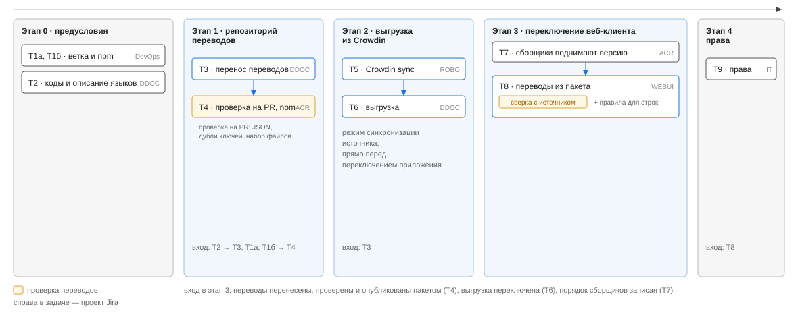

# 05 — План, риски, откат

Пять этапов. До своего переключения веб-клиент работает как сегодня.

Номера задач — из [07](07-tasks.md).

---

## Этап 0 — предусловия

| Что | Зачем | Задачи |
|---|---|---|
| Защитить основную ветку репозитория переводов и дать плану право публиковать npm | в пакет попадает только проверенное; план переводов может положить `@axxon-l10n/*` в `npm-local`, откуда веб-клиент уже ставит зависимости, а `@axxon-l10n` не берётся из публичного реестра | Т1а, Т1б |
| Закрепить эталонный список кодов языков и формат описания языков | имена файлов переводов и описание языков в пакете от него зависят | Т2 |

**Готово, когда:** ветка защищена, у плана есть право публикации, коды записаны
в [06](06-appendix.md).

---

## Этап 1 — `localizationpackages`

Папка `webclient/`; первичный перенос текущих переводов под кодами продукта;
английского файла нет; описание языков. План проверяет
целостность файлов обязательной проверкой на PR в основную ветку и на стадии
Publish публикует npm-пакет рядом с NuGet-пакетами WinForms-клиента.

**Готово, когда:** PR с намеренно испорченным JSON не вливается; один запуск
Publish после изменений веба даёт NuGet и npm-пакет одной версии.

Т3, Т4.

---

## Этап 2 — выгрузка из Crowdin

Проект Web Client выгружает переводы в `localizationpackages`. Источник
Crowdin по-прежнему читает из репозитория веб-клиента. Выбран режим синхронизации источника: перевод изменённой строки
либо остаётся помеченным устаревшим, либо стирается — см. Р12 в
[03](03-decisions.md).

С этого момента **переводы в репозиторий приложения больше не приходят**, и до
его переключения файлы переводов в нём заморожены: правки идут через Crowdin и
попадают в продукт после этапа 3. Поэтому выгрузка переключается
непосредственно перед переключением приложения.

**Готово, когда:** выгрузка из Crowdin даёт коммит в `localizationpackages`, а
в репозитории веб-клиента новых коммитов от локализаторов нет.

Т5, Т6.

---

## Этап 3 — переключение веб-клиента

До переключения у сборщиков записан порядок подъёма версии пакета — тот
же, что для `LocalizationVersion` WinForms-клиента (Т7).

В веб-клиенте: пакет `@axxon-l10n/webclient` точной версией в
`optionalDependencies`, загрузчик из пакета с описанием языков, список
выпускаемых языков, сверка с источником, удаление файлов остальных языков;
правила для разработчиков и ИИ-агентов: skill `add-translation`, решение D-13,
`AGENTS.md`; первая запись в `package.json` — по исключению из D-15.

**Готово, когда:** приложение показывает все языки из списка выпускаемых;
`pt-PT` получает португальский; без пакета сборка проходит на английском с
предупреждением; в репозитории остался только английский источник.

Т7, Т8.

---

## Этап 4 — права

Отзыв у локализаторов записи в репозиторий веб-клиента. Чтение остаётся —
оно нужно синхронизации источника.

Т9.

---

## Риски

| Риск | Что с ним делаем |
|---|---|
| PR с переводами висит непроверенным — в пакете старые переводы | проверка запускается на каждый PR автоматически; её отчёт показывает, что чинить |
| Сборщик забыл поднять версию — в продукте старые переводы | сборка пишет версию пакета в журнал и предупреждает, если в Artifactory есть новее; подъём записан в постоянный порядок сборщиков (Т7), как `LocalizationVersion` |
| Версия поднята в `master`, но не в релизной ветке | так и задумано: релизная ветка держит свою версию; исправление для выпуска — отдельный подъём в ней, порядок в Т7 |
| Новый язык пришёл в пакете раньше, чем приложение его поддерживает (RTL, локаль MUI) | язык показывается только из списка выпускаемых в приложении; в список его вносит владелец продукта после задачи на поддержку |
| Разработчик меняет смысл текста, а на экране старый перевод | Crowdin помечает такие переводы устаревшими, и локализаторы находят их фильтром; если этого мало, режим синхронизации источника можно сменить на стирающий (Т6) |
| Разработчик сменил плейсхолдер у существующего ключа, а перевод старый | сборка отбрасывает эту строку и показывает английский из `strings.json`, в журнале — предупреждение |
| Crowdin sync — настольная утилита на личных токенах одного человека | для веба в перспективе — родная интеграция через `crowdin.yml`, как в Drivers Pack; вопрос в [03](03-decisions.md) |
| Artifactory недоступен или версии пакета нет | сборка проходит на английском источнике с предупреждением; на сборке выпуска — метка Bamboo и заметная строка в журнале, сборщик видит их до выхода; та же зависимость, что у `@axxon-web/*` сегодня |
| Пакет `@axxon-l10n` подменён пакетом из публичного реестра | строка scope в `.npmrc` веб-клиента (Т8), запрет брать `@axxon-l10n` снаружи в Artifactory (Т1б), `resolved` в lockfile указывает на Artifactory |
| Плохой, но формально верный перевод вышел в пакете | сборщик возвращает в приложении прежнюю версию; порядок — в Т7 |
| Правки переводов, пришедшие в репозиторий приложения между этапами 1 и 2, потеряются | перенос делается из Crowdin, а не из репозитория; заморозка с этапа 2 |
| OEM-компоненты веб-клиента вызывают строки продукта по ключам; ключ переименовали или удалили — OEM-сборка ломается | разработчик не переименовывает и не удаляет такие ключи, не согласовав с сопровождающими OEM-ресурсов; правило — в Т8. Зависимость есть уже сегодня и от предложения не зависит; уходит совсем, если OEM-ресурсы веба переедут в репозиторий веб-клиента — открытый вопрос в [03](03-decisions.md) |
| Прямой push в основную ветку репозитория переводов меняет текст в следующем пакете | ветка защищена настройками репозитория: только PR, только с пройденной проверкой (Т1а, Т4) |

---

## Откат

Каждый этап обратим отдельно.

| Этап | Как откатить | Цена |
|---|---|---|
| 1 | ничего не делать: пакеты никто не ставит | нулевая |
| 2 | вернуть адрес выгрузки Crowdin на репозиторий веб-клиента | переводы между откатом и возвратом — повторная выгрузка |
| 3 | обратный merge PR приложения: файлы переводов возвращаются из истории, зависимость уходит из `package.json` | переводы, пришедшие после этапа 2, надо выгрузить в приложение заново |
| 4 | вернуть права | нулевая |

Этапы 2 и 3 связаны: откатывая приложение, надо вернуть и выгрузку,
иначе новые переводы до него не дойдут.

Плохая версия пакета — не откат этапа: сборщик возвращает в приложении прежнюю
версию одним коммитом (Т7).
